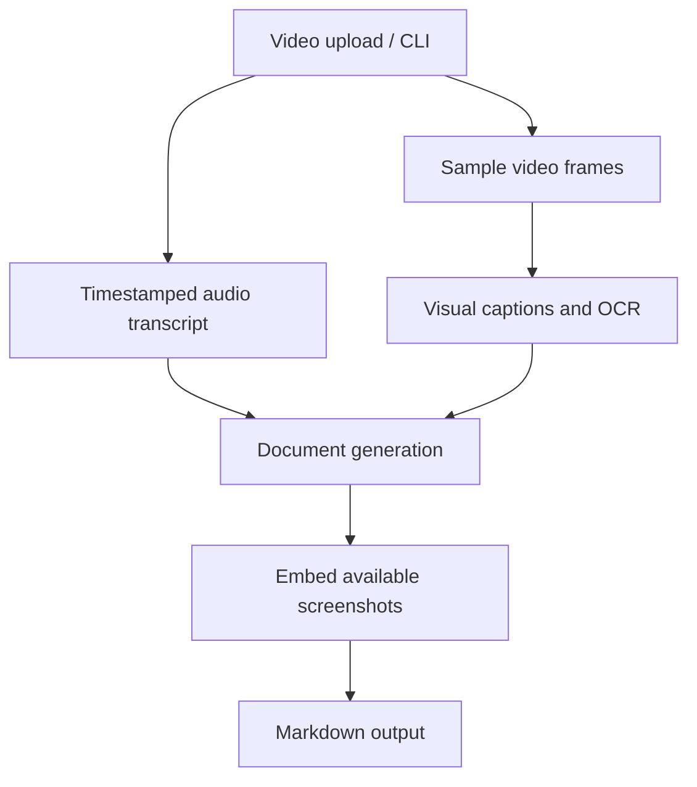

# video2doc-ai Community

[](https://github.com/kibnelbachyr/video2doc-ai-community/actions/workflows/offline-ci.yml)
[](LICENSE)

**From recorded knowledge to structured documentation.** For technical writers and engineers evaluating a video-to-Markdown workflow, start with a credential-free fictional document; use real recordings only in an authorized, separately validated environment.

An experimental multimodal pipeline for turning product demonstrations, training recordings and technical walkthroughs into draft Markdown using Azure AI and the [Diátaxis](https://diataxis.fr/) documentation framework.

The implementation combines timestamped transcription, sampled video frames, visual captions and OCR with language-model generation. The community edition is designed to make the architecture and its trade-offs reproducible without requiring cloud credentials for the offline baseline.

> **[v0.2.0 published experimental pre-release](https://github.com/kibnelbachyr/video2doc-ai-community/releases/tag/v0.2.0) · Experimental · Apache 2.0.** Offline API/CLI execution and synthetic media components are verified in CI. Live-model accuracy, multilingual fidelity, production security, performance and cost have not been validated. Keep the unauthenticated API local; do not upload sensitive recordings or expose it to the internet.

## Quick start — no Azure credentials

Prerequisite: Linux and Python 3.11 (verified in CI); other platforms are not verified against the version snapshot. Dependency installation requires internet access. FFmpeg is needed for real media processing and media tests, not the fully mocked demo.

```bash
git clone https://github.com/kibnelbachyr/video2doc-ai-community.git
cd video2doc-ai-community
git checkout v0.2.0
python -m venv .venv
source .venv/bin/activate
python -m pip install -r requirements-linux-py311.lock
python -m pip check

MOCK_TRANSCRIPTION=true MOCK_VISION=true MOCK_GENERATION=true \
  uvicorn api.main:app --host 127.0.0.1 --port 8000 --workers 1
```

Open http://localhost:8000. In another terminal run `printf 'fictional placeholder' > demo.mp4`, then select that harmless placeholder file, start the pipeline and download the result. The preview displays literal Markdown text rather than interpreting model output as HTML.

Alternatively, run the CLI without any actual video file:

```bash
MOCK_TRANSCRIPTION=true MOCK_VISION=true MOCK_GENERATION=true \
  python pipeline.py --video demo.mp4
```

The generated `output/demo.md` is a fixed, labeled fictional document containing the four Diátaxis sections. It does **not** analyze your video in this mode. See [local development](docs/local-dev.md) for other configurations.

## Architecture



| Stage | Live implementation | Offline baseline |
| --- | --- | --- |
| Transcription | Azure AI Speech | Fixed fictional transcript |
| Visual context | FFmpeg + Azure AI Vision | Fixed fictional captions/OCR; frame extraction bypassed |
| Generation | Azure AI Foundry, GPT-4.1 configuration | Deterministic synthetic Markdown |
| State and results | Blob Storage (API); local files (CLI) | Process memory (API); local files (CLI) |
| Preview | Literal-text browser preview | Same preview, no third-party renderer |

The API uses a background thread and polling. The infrastructure templates target Azure Container Apps, Static Web Apps, Blob Storage, Key Vault and managed identity. This is a proposed live deployment architecture, not proof of an operational deployment. All Azure deployment workflows require explicit manual dispatch and may incur costs.

See the [architecture](docs/architecture.md) and [ADR-001](docs/adr/001-execution-and-trust-boundaries.md) for trust boundaries, failure modes, state management and production prerequisites.

## Engineering evidence

| Capability | Evidence |
| --- | --- |
| Offline API and CLI | Credential-free smoke tests; upload denial and unknown-job handling |
| Local media components | Generated test-pattern video and audio; real frame/audio extraction, timestamp formatting and embedding |
| Untrusted input/output | Filename rejection; literal-text bounded preview |
| Automated verification | Released baseline: 28 Python and 3 JavaScript tests, selected static checks, pinned Linux runtime versions and separate dependency advisory audit |
| AI quality | Four fictional bilingual fixtures; 20 offline evaluator self-test variants; proposed human-review rubric; no live results |

[Verified release CI](https://github.com/kibnelbachyr/video2doc-ai-community/actions/runs/45911493736) reported no known vulnerabilities in the audited Python packages at the time of the scan. This does not cover every dependency, container, operating system or application security risk.

To run the tests locally with Python 3.11, FFmpeg and Node.js 24 available:

```bash
python -m pip install -r requirements-linux-py311.lock
python -m pip install -c requirements-linux-py311.lock httpx==0.27.2
python scripts/verify_source.py
python -m unittest discover -s tests -v
node --test tests/test_preview.js
python -m evals.run_offline --output evaluation-report.json
```

Full details: [engineering evidence and limitations](docs/portfolio-readiness.md) · [evaluation protocol](evals/README.md) · [changelog](CHANGELOG.md).

v0.2.0 adds process-local admission and retention, post-multipart upload limits, bounded media subprocesses and image embedding. These limits do not provide authentication, filesystem isolation, a durable distributed queue or end-to-end resource guarantees. Dependency pins target Linux/Python 3.11 and are not a hash-locked cross-platform build. See [API limits](docs/api.md) and [evaluation protocol](evals/README.md). The published tag is immutable; future releases require separate CI and owner approval.

## Repository guide

| Path | Purpose |
| --- | --- |
| `api/` | FastAPI endpoints, job state and background runner |
| `src/` | Shared audio, visual and generation pipeline |
| `ui/` | Vanilla JavaScript browser interface |
| `infra/` | Experimental Azure Bicep deployment templates |
| `prompts/` | Diátaxis generation instructions |
| `tests/` | Offline, media and preview regression tests |
| `evals/` | Synthetic bilingual evaluation specifications |
| `pipeline.py` | Standalone CLI |

## Documentation

- [Local development](docs/local-dev.md) and [configuration](docs/configuration.md)
- [Pipeline](docs/pipeline.md), [REST API](docs/api.md) and [frontend](docs/frontend.md)
- [Azure architecture](docs/azure-stack.md), [infrastructure](docs/infrastructure.md) and [manual deployment](docs/deployment.md)
- [Production readiness plan](docs/production-readiness-plan.md) and [illustrative cost assumptions](docs/cost-estimation.md)
- [Project presentation](PRESENTATION.md)

## Contributing and security

Contributions to reproducibility, tests, documentation and architecture are welcome. Read [CONTRIBUTING.md](CONTRIBUTING.md) and [SECURITY.md](SECURITY.md) before sharing examples or reporting vulnerabilities. Use synthetic or expressly licensed fixtures; never include private recordings, credentials or organizational details.

## License and attribution

[Apache License 2.0](LICENSE) applies to the project's original source and documentation. Third-party dependencies retain their own licenses; comprehensive dependency-license review remains outstanding.

Maintainer: [@kibnelbachyr](https://github.com/kibnelbachyr). AI-assisted development and documentation included Claude (Anthropic) and ChatGPT (OpenAI). The maintainer is responsible for review and release decisions.
